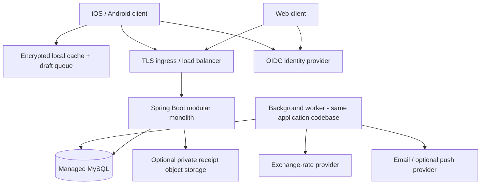

# Money Tracker and Split Application - Technical Design

**Status:** Proposed architecture, not an implemented feature set  
**Date:** 2026-11-02  
**Backend:** Java, Spring Boot  
**Database:** MySQL  
**Target:** MVP with a clear path to production growth

## 1. Purpose and design decisions

Build a money management application for individuals and groups, accessible through web, iOS, and Android clients. Users track personal income, spending, categories, budgets, and monthly summaries; groups record shared bills and settle outstanding balances.

### 1.1 Confirmed requirements

| Area | Decision |
|---|---|
| Shared ledgers | Dedicated groups with members and shared expenses |
| Splitting | Equal, percentage, shares, and exact unequal amounts |
| Currency | Multiple expense currencies, converted into a group base currency |
| Simplification | Fast reduced-transfer suggestions, without a global-minimum guarantee |
| Settlements | Record external payments, optionally including a payment reference; no money movement |
| Clients | Web, iOS, and Android |
| Offline | Cached viewing and expense creation; no offline editing or deletion |
| Personal tracking | Income, expenses, categories, budgets, and monthly summaries |
| Authorization | No group administrators; only an expense's creator may edit or delete it |
| Hosting | Cloud-neutral containers and managed MySQL |

### 1.2 Proposed defaults

The following are architectural recommendations rather than additional confirmed requirements:

- React with TypeScript for web and React Native for iOS/Android. Native clients can use the same API and synchronization protocol.
- Managed OpenID Connect (OIDC) identity provider with email sign-in; additional social identity providers can be added later.
- One immutable base currency per group and one reporting currency per personal ledger.
- Maximum 50 members per group for the MVP, enforced in configuration.
- One payer per expense in the MVP; the data model allows multiple payer allocations later.
- Payment confirmation by the receiving member before a settlement changes balances.
- No expense approval workflow. Creator edits take effect immediately and produce an audit event.
- Offline creation applies to shared expenses and personal income/expense entries.
- Receipt attachments and push notifications are optional later increments, not launch dependencies.

### 1.3 Non-goals

The MVP does not provide payment processing, bank synchronization, lending, tax accounting, investment tracking, cross-group debt netting, guaranteed globally minimal settlements, offline mutation of existing records, or arbitrary historical FX revaluation.

## 2. Quality attributes and capacity assumptions

These are planning assumptions, to be validated by load testing rather than capacity guarantees.

| Attribute | Initial design target |
|---|---|
| Scale | 10,000 registered users, 1,000 daily active users, 100 concurrent active sessions |
| Load | 50 requests/second sustained and 200 requests/second short bursts |
| API latency | p95 below 300 ms for balance/list reads and 500 ms for writes, excluding external providers |
| Availability | 99.9% monthly backend availability target; dependency availability included |
| Financial correctness | No floating-point money calculations; every posted journal batch balances to zero |
| Recovery | RPO at most 5 minutes and RTO at most 60 minutes, dependent on managed database configuration |
| Privacy | Private personal ledgers; group financial data available only to active members |
| Offline | Acknowledged local drafts survive app restarts and are never silently discarded |
| Accessibility | Web and mobile flows target WCAG 2.2 AA |

Availability and recovery objectives require redundant application instances, managed database failover, point-in-time recovery, and exercised restore procedures. They are not properties of Spring Boot alone.

## 3. Logical architecture

Use a **modular monolith**, not microservices, for the MVP. Expense creation, journal posting, balance updates, synchronization events, and idempotency records can then commit atomically in one MySQL transaction.



External provider calls must not occur while holding ledger locks. Fetch FX rates in advance and send notifications after commit through a transactional outbox.

### 3.1 Modules and responsibilities

Suggested package root: `com.money.split`.

| Module | Responsibilities |
|---|---|
| `identity` | OIDC subject mapping, profile, preferences, account lifecycle |
| `groups` | Membership, invitations, shared ledger settings |
| `expenses` | Input validation, splits, immutable revisions, creator authorization |
| `ledger` | Journal posting, balances, reversals, reconciliation |
| `settlements` | External payment proposals, confirmation, reversal |
| `fx` | Rate ingestion, provenance, historical conversion |
| `personal` | Personal entries, categories, shared-expense attribution |
| `budgets` | Monthly budget calculation and thresholds |
| `reports` | Monthly summaries and read projections |
| `sync` | Draft submission, incremental feeds, snapshots, idempotency |
| `notifications` | Outbox dispatch and delivery retries |
| `platform` | Security, observability, persistence, HTTP error contracts |

Each domain module separates API DTOs, application services, domain logic, and persistence adapters. Controllers do not calculate balances. Modules invoke public application interfaces, not another module's repositories. Keep monetary calculation helpers small and shared; avoid a generic business-logic utility package.

### 3.2 Technology alignment with the existing workspace

The current Gradle build declares Java 25, Spring Boot 4.1.2, Spring MVC, Spring Data JDBC, Liquibase, MySQL Connector/J, Actuator, and springdoc OpenAPI.

The design retains Spring Data JDBC rather than introducing JPA. Use explicit repositories and SQL for aggregates, locking, reporting, and journal writes. Liquibase owns schema changes.

Implementation should add Spring Security/OIDC resource-server support and Bean Validation through compatible Spring Boot starters. Verify selected dependency versions and runtime compatibility at implementation time; this document does not upgrade the project or assert that its dependencies have been resolved.

## 4. Financial model and invariants

### 4.1 Money representation

- API money amounts are decimal strings with a separate ISO 4217 currency code.
- Persist amounts as signed `BIGINT` minor units; original positive expense amounts and allocation amounts have positive/nonnegative constraints.
- Currency metadata defines the exponent: USD uses 2, JPY uses 0, and KWD uses 3.
- Use `BigDecimal` for decimal input and FX calculation, then checked conversion into minor units. Never use `float` or `double`.
- Persist rates as `DECIMAL(28,12)` and percentage/share weights as `DECIMAL(20,8)`.
- Reject unsupported currencies, excess fractional digits, amounts outside configured limits, and arithmetic overflow.
- Percentage inputs must total exactly 100 at the supported precision. Shares must be strictly positive.
- Exact-amount splits must sum exactly to the expense total in its original currency.
- Allocations with a resulting zero amount are allowed after rounding; the overall expense must be positive.

### 4.2 Expense split calculation

Splits are calculated first in the expense's original currency:

1. Validate participants are active group members and have distinct identifiers.
2. Convert the total into integer minor units.
3. Derive ideal allocations from equal weights, percentages, shares, or exact amounts.
4. For weighted splits, take the floor of each ideal allocation.
5. Assign remaining minor units to the largest fractional remainders.
6. Break ties using a stable participant-ID ordering, not request order.

Examples:

| Method | Input | Allocation |
|---|---|---|
| Equal | USD 10.00 across A, B, C; IDs ordered A, B, C | 3.34, 3.33, 3.33 |
| Percentage | USD 100.00; 50%, 30%, 20% | 50.00, 30.00, 20.00 |
| Shares | USD 60.00; weights 1, 2, 3 | 10.00, 20.00, 30.00 |
| Exact | USD 50.00; amounts 12.00 and 38.00 | 12.00, 38.00 |

Payer allocations must sum to the same total. For the single-payer MVP, the payer funds the full amount.

### 4.3 FX conversion

The group currency is the settlement and balance currency. Preserve both original and base-currency allocations.

Rate convention: `1 original-currency major unit = rate base-currency major units`.

For conversion:

```text
base_minor_total =
    round_half_even(
        original_minor_total / 10^original_exponent
        * rate
        * 10^base_exponent
    )
```

Convert participant allocations and payer allocations independently using largest-remainder apportionment, so each converted allocation set sums to the rounded base total. Reject an expense that rounds to zero in the base currency. Store all final allocations; do not reconstruct financial history using today's rates.

Each revision stores the rate, currency pair, provider/source, rate date, retrieval time, and whether it was manually supplied.

- Same-currency expenses use rate 1.
- Use a historical daily rate for the expense's group-local calendar date.
- On weekends/holidays, use the latest available rate on or before that date, within a configured maximum age of seven calendar days.
- If there is no eligible rate, require a positive manual rate or retain the draft as `NEEDS_RATE`. Do not silently use a current or stale rate.
- Provider outage does not block same-currency expenses or valid cached-rate conversions.
- Offline estimates are provisional. The server returns the applied rate and authoritative allocations after synchronization.
- If an edit changes amount, currency, or expense date, create a new financial revision and explicitly return any changed conversion. Metadata-only edits preserve the existing conversion.

Example: a EUR 90.00 expense at a stored EUR-to-USD rate of 1.10 contributes USD 99.00 to a USD group's ledger. Three equal participants receive USD 33.00 allocations.

Base currency cannot change after a ledger receives its first posting. Existing history is not revalued when new rates arrive. Personal reporting conversion is separately snapshotted into the user's personal reporting currency.

### 4.4 Ledger sign convention

For member `u`:

```text
balance[u] = base_amount_paid[u] - base_share_consumed[u]
             + outgoing_confirmed_settlements[u]
             - incoming_confirmed_settlements[u]
```

- Positive balance: the member should receive money.
- Negative balance: the member owes money.
- Sum of member balances in a group is always zero.

A paying USD 90.00 for A, B, and C equally produces A = +60.00, B = -30.00, and C = -30.00. A confirmed USD 30.00 settlement from B to A adds +30.00 to B and -30.00 to A.

Represent each expense revision as a journal batch containing `PAID` positive postings and `OWED` negative postings. Confirmed settlements also create balanced batches. Journal entries are immutable. Financial corrections append an exact reversal batch and, when applicable, a replacement batch.

The immutable journal is the source of truth. `group_balance` is a rebuildable read projection updated synchronously in the same transaction; clients and expense CRUD operations cannot write it directly.

## 5. Groups, permissions, and lifecycle

There is **no group administrator or owner permission**. Store the creator for provenance only.

| Action | Authorized actor |
|---|---|
| Create a group | Authenticated user |
| View group data and invite another user | Active member |
| Accept an invitation | Its intended authenticated recipient |
| Add an expense | Active member; payer and participants must be active members |
| Edit/delete an expense | Original expense creator, while still an active member |
| Rename group | Active member, using optimistic concurrency and audit |
| Remove another member | Not supported in the MVP |
| Leave group | The member themselves, only at zero balance with no pending settlements involving them |
| View/edit personal data | The personal ledger's user only |

Creating an expense on behalf of another payer does not transfer editing rights to that payer.

Invitation acceptance is explicit. Invitations use expiring, one-time tokens stored as hashes; arbitrary email addresses are not immediately added to a group. Every active member can invite, so notifications and audit history make additions visible.

Membership rows persist after departure. Existing expenses retain historical participants. A creator cannot change an expense after leaving; before leaving, the UI warns that editing access will be lost. Rejoining may restore membership access but does not rewrite the audit history.

An expense edit or reversal must not change a departed member's balance. Reject such financial changes with `FORMER_MEMBER_AFFECTED` until the affected person rejoins. This prevents a member who left at zero balance from acquiring an inaccessible new debt.

When the last member leaves a zero-balance group, mark it archived. Explicit group deletion or unilateral archival is not supported in the MVP. Former members retain a departure-time export locally but cannot fetch ongoing group activity.

Personal categories are private. Shared expenses can contain a common spending-category code; each participant may independently override their own reporting category.

## 6. Debt simplification and settlements

### 6.1 Reduced-transfer algorithm

Use a greedy debtor/creditor matching algorithm in integer group-currency minor units:

```text
creditors = max-heap of members with balance > 0
debtors   = max-heap of members with balance < 0, keyed by absolute balance

while both heaps are nonempty:
    creditor = pop largest credit
    debtor = pop largest debt
    amount = min(creditor.credit, debtor.debt)
    suggest debtor -> creditor for amount
    reduce both remaining amounts
    reinsert each nonzero remainder
```

Break ties by stable member ID. Complexity is `O(n log n)` with at most `n - 1` suggested transfers for `n` nonzero balances.

**This does not guarantee the minimum possible number of transfers.** For example, credits of 8 and 7 and debts of 7, 5, and 3 can take four greedy transfers, although a three-transfer solution exists. Product copy must say "simplified payments" rather than promise a mathematically optimal solution.

The A owes B 10 / B owes C 10 example reduces to A paying C 10 because B's net balance is zero.

Simplification generates suggestions; it does not change journal history, original expense liabilities, or confirmed payments. Net positions remain identical. MVP simplification allows any active debtor to settle with any active creditor in the same group; restricted creditor relationships would require a different algorithm.

Return the ledger version with every suggestion set. Suggestions are advisory and refresh after financial changes. Multiple currencies never enter the algorithm directly; all inputs are base-currency balances.

### 6.2 Settlement workflow

```text
PENDING -> CONFIRMED
PENDING -> REJECTED
PENDING -> CANCELLED
CONFIRMED -> REVERSAL_PENDING -> REVERSED
                            -> CONFIRMED (reversal rejected/cancelled)
```

- Sender records an external payment to a different active group member.
- Receiver confirms or rejects it; sender may cancel only before confirmation.
- Only confirmation changes balances, exactly once.
- Either party can request a correction to a confirmed settlement; the other party must approve its reversal. Never edit a confirmed settlement's amount in place.
- Store settlement amount in the group base currency. If paid externally in another currency, separately store its original amount and agreed conversion as optional evidence; it does not introduce a second financial posting.
- Pending settlements do not count as completed payments or personal spending.
- Payment references are user-supplied metadata, not proof that a bank transfer occurred.

The creation request can reference a suggestion's ledger version. Reject stale suggestion-based creation with `LEDGER_CHANGED`. At confirmation, recompute whether sender debt and receiver credit still cover the amount; if not, return `SETTLEMENT_BALANCE_CHANGED` and require a revised record. No silent amount adjustment occurs.

Allow valid partial settlements. Pending records do not reserve balances, so concurrent confirmations must serialize under the group ledger lock and revalidate.

## 7. Personal tracking and budgets

### 7.1 Personal ledger

Support manual `INCOME` and `EXPENSE` entries with category, original amount/currency, date, note, reporting-currency snapshot, and revision history.

Every participant's own shared-expense allocation contributes to their personal spending, regardless of who paid the bill. Do not count the entire bill paid by that user as personal consumption.

Keep consumption and cash-flow views separate:

| Event | Spending/budget impact | Cash-flow impact |
|---|---|---|
| Personal manual expense | Full reporting amount | Outflow |
| Personal manual income | No spending impact | Inflow |
| Shared expense | User's own share | User's payer allocation, if any |
| Settlement sent/received | None | Outflow/inflow respectively |
| Expense reversal | Reverse attributed spending | Reverse prior recorded expense cash-flow allocation |

Shared personal attribution references an immutable expense revision and user. It is not a second editable copy of the group expense. A group expense correction reverses previous attribution and creates replacement attribution.

For reporting currency conversions, retain the old snapshot for the reversal and obtain a new snapshot for a replacement. If a reporting rate is unavailable, keep attribution pending with an explicit incomplete-summary flag rather than silently omitting the item.

Manual entries are independent. Warn users not to manually duplicate already-attributed shared expenses. Bank import/deduplication is outside MVP scope.

### 7.2 Budgets and monthly summaries

- Monthly overall and category budgets use the personal ledger's reporting currency.
- Overall and category budgets are independent limits, not additive spending totals.
- Compute spending from manual expenses plus own shared allocations, less reversals.
- Exclude income and settlements from budget consumption.
- Store expense business date and reporting month explicitly; use the user's configured IANA timezone to interpret newly submitted personal timestamps.
- Group expense business dates use the group's timezone. Preserve each attribution's assigned reporting month so later preference changes do not silently reclassify history.
- Disallow reporting-currency changes once postings exist in the MVP; explicit historical migration is a later feature.
- Support configurable 80% and 100% budget alerts with unique per-budget/month/threshold dispatch keys.
- Historical edits recalculate affected months. Previously sent alerts remain in audit history; the UI shows current totals.
- Reports show total income, spending, cash flow, budget remaining, category breakdown, and outstanding group balances. Outstanding balances remain separated by group currency, not added across currencies.

## 8. MySQL data model

Use InnoDB, foreign keys, strict SQL mode, UTC timestamps, and application-generated UUIDs stored as `BINARY(16)`. Money and currency fields are never nullable on posted financial records. Use indexed `user_id` and `group_id` for authorization-scoped access.

### 8.1 Principal tables

| Table | Key fields and purpose |
|---|---|
| `app_user` | `id`, unique `(issuer, subject)`, display name, timezone, status |
| `currency` | `code`, exponent, supported flag |
| `split_group` | `id`, name, base currency, timezone, creator ID, status, resource version, ledger version, sync sequence |
| `group_member` | PK `(group_id, user_id)`, status, joined/left timestamps; no role column |
| `group_invitation` | `id`, group ID, intended recipient, token hash, expires at, accepted at |
| `expense` | `id`, group ID, immutable creator ID, current revision ID, deleted flag, optimistic version |
| `expense_revision` | `id`, expense ID, revision number, original/base total, currencies, split method, business date, note, FX provenance, actor ID |
| `expense_payer` | PK `(revision_id, user_id)`, original and base paid minor units |
| `expense_split` | PK `(revision_id, user_id)`, input weight/amount, original and base owed minor units |
| `journal_batch` | `id`, group ID, source type, source revision/settlement ID, reversal-of ID, ledger version |
| `journal_entry` | `id`, batch ID, group ID, user ID, signed base minor units, posting type |
| `group_balance` | PK `(group_id, user_id)`, signed base minor units, latest ledger version |
| `settlement` | `id`, group ID, sender/receiver IDs, base amount, optional original currency evidence/reference, state, version |
| `settlement_event` | `id`, settlement ID, actor ID, action, timestamp; immutable transition history |
| `fx_rate` | `id`, currency pair, rate date, rate, provider, retrieved at; immutable provider snapshots |
| `personal_ledger` | `id`, unique user ID, reporting currency, sync sequence, version |
| `personal_category` | `id`, user ID, name, income/expense kind, archived flag |
| `personal_entry` | `id`, ledger ID, kind, current revision ID, deleted flag, version |
| `personal_entry_revision` | Original/reporting amounts, date/month, category, FX snapshot, actor, revision number |
| `personal_attribution` | User ID, source revision ID, reporting allocation, date/month, private category override, reversal-of ID, readiness state |
| `budget` | `id`, user ID, month, optional category ID, reporting minor-unit limit, version |
| `audit_event` | Actor, resource, action, revision references, request ID, timestamp |
| `sync_change` | PK `(scope_type, scope_id, sequence)`, entity ID, revision/version, event type, immutable payload |
| `idempotency_record` | Unique `(user_id, operation_id)`, method/path, canonical request hash, resource ID, response, expires at |
| `outbox_event` | `id`, type, payload, created at, available at, attempt count, processing lease, delivered at |
| `notification_delivery` | Unique event/channel/recipient key, provider delivery reference, delivery status |

Amounts and currency pairs in personal revisions and attributions include their FX provenance just as group revisions do. Original currency differs from base/reporting currency only when a valid snapshot exists.

### 8.2 Constraints and indexes

- Unique `(expense_id, revision_number)` and `(personal_entry_id, revision_number)`.
- Unique financial source key on journal batches; separate unique reversal-of key prevents double reversal.
- Composite membership foreign keys for group expense payer/split participants and journal users. Authorization still checks active status.
- Composite group-aware foreign keys prevent linking an expense or settlement to another group's journal.
- Index expenses by `(group_id, business_date, id)` through an appropriate current-revision query/projection.
- Index journal entries by `(group_id, user_id, batch_id)` and batches by `(group_id, ledger_version)`.
- Index personal reporting reads by `(user_id, reporting_month, category_id)`.
- Index outbox scanning by `(delivered_at, available_at, id)`.
- Check settlement sender differs from receiver and amount is positive.
- Enforce one overall budget per user/month and one per category/month. MySQL nullable unique columns do not enforce the overall-budget rule; use an explicit non-null scope key or separate overall/category tables.

MySQL row constraints cannot enforce cross-row allocation sums or balanced batches. The ledger posting service enforces these inside the transaction; reconciliation independently checks them.

### 8.3 Write transaction and concurrency

For a financial command:

1. Validate request shape and resolve a usable FX snapshot outside the ledger transaction.
2. Start a transaction and claim the user-scoped idempotency key.
3. Lock the group row with `SELECT ... FOR UPDATE`.
4. Recheck active membership, permissions, expected resource version, and financial preconditions.
5. Append the revision and balanced journal batch; append reversal first if correcting history.
6. Update affected balance rows and increment the ledger version.
7. Append audit, personal-attribution outbox, and ordered group-sync events.
8. Persist the command response/idempotency result and commit.

The group row serializes membership changes, ledger writes, settlement confirmations, and sync-sequence assignment. It is appropriate for small groups, while allowing independent groups to write concurrently. Do not use a global lock.

Personal writes similarly lock their ledger row. Personal-attribution workers lock only the personal ledger, never a group row, and process immutable source snapshots from the outbox. This avoids group/personal lock-order deadlocks. Personal projections are eventually consistent; the UI can display "updating" with the last processed source version.

Optimistic versions on expenses and settings detect stale client edits. A bounded retry for database deadlocks is permitted for idempotent commands; authorization and business-validation failures are not retried.

## 9. API design

REST JSON under `/api/v1`, documented with OpenAPI. All list endpoints use opaque cursor pagination and bounded page sizes. Never trust a caller-supplied user ID as its identity.

### 9.1 Main endpoints

| Method and path | Purpose |
|---|---|
| `GET /me`, `PATCH /me` | Profile and preferences |
| `POST /groups`, `GET /groups` | Create and list memberships |
| `GET /groups/{groupId}`, `PATCH /groups/{groupId}` | Read/update allowed group settings |
| `POST /groups/{groupId}/invitations` | Invite a recipient |
| `POST /invitations/{token}/accept` | Accept invitation |
| `POST /groups/{groupId}/leave` | Leave subject to financial preconditions |
| `POST /groups/{groupId}/expenses` | Create shared expense |
| `GET /groups/{groupId}/expenses` | Paginated expenses |
| `GET /groups/{groupId}/expenses/{expenseId}` | Expense detail |
| `PUT /groups/{groupId}/expenses/{expenseId}` | Creator-only replacement revision |
| `DELETE /groups/{groupId}/expenses/{expenseId}` | Creator-only logical deletion with reversal |
| `GET /groups/{groupId}/balances` | Authoritative balances and ledger version |
| `GET /groups/{groupId}/simplified-payments` | Advisory debt simplification |
| `POST /groups/{groupId}/settlements` | Sender records external payment |
| `POST /groups/{groupId}/settlements/{id}/confirm` | Receiver confirms |
| `POST /groups/{groupId}/settlements/{id}/reject` | Receiver rejects |
| `POST /groups/{groupId}/settlements/{id}/cancel` | Sender cancels pending record |
| `POST /groups/{groupId}/settlements/{id}/reversal-requests` | Party requests reversal |
| `POST /groups/{groupId}/settlements/{id}/reversal-requests/{requestId}/approve` | Other party approves |
| `POST /groups/{groupId}/settlements/{id}/reversal-requests/{requestId}/reject` | Other party rejects |
| `POST /groups/{groupId}/settlements/{id}/reversal-requests/{requestId}/cancel` | Requester cancels |
| `GET /groups/{groupId}/activity` | Member-visible audit activity |
| `POST /personal/entries`, `GET /personal/entries` | Manual income/expense entries |
| `PUT /personal/entries/{id}`, `DELETE /personal/entries/{id}` | Revision/reversal of personal entry |
| `GET /personal/categories`, `POST /personal/categories` | Private categories |
| `PATCH /personal/categories/{id}` | Rename/archive category |
| `GET /personal/shared-attributions`, `PATCH /personal/shared-attributions/{id}/category` | Own shared-spending attribution/category |
| `GET /personal/budgets`, `POST /personal/budgets` | Read/create monthly budgets |
| `PUT /personal/budgets/{id}`, `DELETE /personal/budgets/{id}` | Update/remove budget |
| `GET /personal/reports/monthly?month=2026-11` | Income/spending/budget summary |
| `GET /fx/rates?from=EUR&to=USD&date=2026-11-01` | Available rate and provenance |
| `GET /sync/changes?scope=...&cursor=...` | Authorized incremental changes |
| `POST /sync/snapshots` | Start an authorized consistent bootstrap snapshot |
| `GET /sync/snapshots/{id}?cursor=...` | Read snapshot pages |
| `GET /operations/{operationId}` | Recover a command outcome after lost response |

Mutating financial endpoints require `Idempotency-Key`. Creator edits/deletes and state transitions require `If-Match` using the resource ETag; missing preconditions return 428, and version mismatch returns 412.

### 9.2 Expense request example

```http
POST /api/v1/groups/6f9e8751-7452-4f97-81b0-a03d2f036e59/expenses
Authorization: Bearer <access-token>
Idempotency-Key: 3e36b05f-cad1-43cc-839a-4cb96ef14084
Content-Type: application/json
```

```json
{
  "id": "cbca3c3a-9f1a-484b-a774-46e3bbc7cbe6",
  "description": "Dinner",
  "amount": "90.00",
  "currency": "EUR",
  "businessDate": "2026-11-01",
  "payerId": "2abdc1c1-e882-4b2c-b2a8-80f0eb8c32b8",
  "split": {
    "method": "EQUAL",
    "participants": [
      {"userId": "2abdc1c1-e882-4b2c-b2a8-80f0eb8c32b8"},
      {"userId": "12a57131-792f-42b2-8eb5-204ff01c233d"},
      {"userId": "ec9ba59e-8fb5-4820-a2ef-ff2249e4a397"}
    ]
  },
  "fx": {
    "mode": "PROVIDER"
  }
}
```

For `PERCENTAGE`, participants carry a decimal-string `percentage`; for `SHARES`, a `shares` weight; for `EXACT`, an original-currency `amount`. Reject method-incompatible fields. Manual FX requests use `mode: MANUAL` and a positive decimal-string `rate`.

The response includes resource version/ETag, original and base totals, stored FX metadata, final participant/payer allocations, ledger version, and sync sequence. The creator comes from the authenticated identity, not the body.

### 9.3 Errors

Use `application/problem+json` with `type`, `title`, `status`, safe `detail`, stable `code`, `instance`, and `requestId`. Validation failures include field-level errors without sensitive values.

| Status | Examples |
|---|---|
| 400 | Invalid split, unsupported currency, invalid precision/date |
| 401 | Missing/invalid authentication |
| 403 | Active member attempts to edit another creator's expense |
| 404 | Missing resource or resource outside caller's visibility |
| 409 | Ledger changed, key reused with different payload, duplicate resource ID, former member affected |
| 410 | Expired sync cursor/snapshot or operation retry window |
| 412 / 428 | Failed/missing resource version precondition |
| 422 | No eligible FX rate, invalid settlement financial preconditions |
| 429 | Rate limit exceeded, with retry guidance |
| 503 | Temporary service failure; retry only with the same operation ID |

## 10. Offline storage and synchronization

### 10.1 Client state

Mobile clients use encrypted SQLite for cache and drafts; keep encryption keys in Keychain/Keystore. Cache only necessary data and partition storage by authenticated account. A web client may use IndexedDB for a cache, but web offline creation is not required for the MVP.

Draft lifecycle:

```text
LOCAL_DRAFT -> QUEUED -> UPLOADING -> SYNCED
                         |             |
                         +-> RETRYABLE |
                         +-> NEEDS_ACTION
```

A queued draft stores client-generated resource UUID, operation UUID, canonical payload, local creation time, and provisional calculation. Freeze the payload once a submission might have reached the server. An intentional corrected submission after a definitive rejection receives a new operation ID.

Use exponential backoff with jitter for network failures, 429, and retryable 5xx errors. An expired login pauses uploading and asks the user to authenticate. Removed membership, unsupported currency, and unresolved rates become visible `NEEDS_ACTION` drafts.

Do not permit offline invitations, settlements, or edits/deletes. Balance displays clearly indicate cached time and exclude draft estimates from authoritative settlement suggestions.

### 10.2 Duplicate prevention

- Scope operation IDs to authenticated user and bind them to method, path, and canonical payload hash.
- Same key/same request returns its original result without another posting.
- Same key/different payload returns 409.
- Keep successful idempotency results for 90 days, with expiration communicated to clients.
- Keep entity UUID uniqueness and financial source uniqueness indefinitely while financial records are retained.
- For an uncertain result, query `/operations/{operationId}` and reconcile by resource UUID before resubmitting.
- After the automatic retry window expires, do not invent a new resource ID and blindly retry. Require explicit recovery of the existing entity or user-assisted resolution.

Drafts never disappear merely because retry metadata expires. On logout, warn about unsynchronized drafts; allow synchronization or explicit discard before removing that account's encrypted local data.

### 10.3 Incremental download and snapshots

Each group and personal ledger has its own monotonically increasing sync sequence, assigned while its scope row is locked in the committing transaction. Do not use a raw global auto-increment event ID as a safe cursor: transactions can commit out of order and cause skipped changes.

Changes include immutable revision payloads or explicit tombstones, membership changes, and updated projection versions. Clients apply changes and advance their cursor in one local database transaction.

For bootstrap/resynchronization:

1. Create an authorized, bounded-lifetime server snapshot from a consistent database read view.
2. Capture that read view's scope high-water sequence together with the entity state.
3. Materialize paginated snapshot data; do not page a live, changing entity table.
4. Client installs all pages atomically, then fetches changes after the captured sequence.

Retain incremental changes for 90 days initially. An expired cursor returns 410 and requires a fresh snapshot while preserving unsent drafts. Recheck membership on every snapshot page and change request; logout and membership removal invalidate cached access tokens/snapshot access as appropriate.

Membership revocation cannot remotely erase data from an offline device. Document this limitation and purge group cache on the next authorized membership refresh.

## 11. Security and privacy

- OIDC authorization code flow with PKCE for mobile; validate access-token issuer, audience, signature, and expiry in Spring Security.
- Prefer a web backend-for-frontend session: browser holds a secure, HttpOnly, SameSite cookie; server holds provider tokens. Protect cookie-authenticated mutations with CSRF defenses.
- Keep mobile refresh tokens in platform secure storage, not ordinary SQLite or web local storage.
- Enforce group membership and creator checks server-side on every resource operation, including synchronization and exports.
- Personal reporting endpoints always derive the ledger owner from the principal.
- Use TLS for transit and managed database/storage encryption at rest.
- Store secrets in deployment secret management; inject configuration through environment variables. Use separate least-privilege runtime and Liquibase migration database users.
- Disable public Actuator administration endpoints; expose health/readiness appropriately and protect metrics.
- Use parameterized SQL and strict field validation; bound description/reference lengths and list sizes.
- Apply per-user/IP limits to authentication-related routes, invitations, expense creation, and synchronization.
- Keep logs free of access tokens, invitation tokens, payment references, expense notes, and sensitive personal data.
- Any future receipts use private object storage, short-lived download URLs, file-size/type checks, and malware scanning.
- Audit records record actor/action/revision references rather than unrestricted copies of sensitive requests.

Account deletion pseudonymizes shared historical identity where retention is necessary for other members' balances; it must not break journal integrity. Personal data can be erased according to the configured retention policy. Jurisdiction-specific retention, consent, and privacy obligations require legal review before production; no particular compliance certification is claimed.

## 12. Deployment and operations

### 12.1 Cloud-neutral topology

- Public ingress/load balancer terminates TLS and routes to at least two stateless API instances for the availability target.
- Container platform may be a managed container service; Kubernetes is not required for the MVP.
- Managed MySQL runs on a private network with failover, backups, and point-in-time recovery.
- Worker instances use the same release artifact with a worker profile and outbox leases. Workers do not expose public API routes.
- Optional managed Redis can support multi-instance rate limiting or ephemeral caches later; it is not the ledger source of truth.
- Use private object storage only when receipt support is implemented.

Use liveness/readiness probes, graceful shutdown, bounded connection pools, and request timeouts. Size aggregate database connections across API and worker replicas, not per instance in isolation.

Run Liquibase as a controlled release job, not concurrently from every production replica. Use expand/contract migrations so old and new application versions can overlap during a rolling deployment.

### 12.2 Outbox and failure handling

Outbox processing is at least once. Claim rows with a lease/`SKIP LOCKED` strategy, process outside the claim transaction, and persist completion. Expired leases allow recovery after crashes.

Consumers deduplicate immutable event IDs. Personal-attribution consumers must process each expense's revision transitions in order, or maintain a per-source version gate and explicitly defer gaps; out-of-order edits must not produce incorrect spending.

Notifications carry provider idempotency keys where supported. Delivery duplication may remain possible if a provider has no idempotent send API; never claim exactly-once external email delivery.

Use bounded retries and a visible dead-letter state with operational replay. FX ingestion failures surface health/age metrics; journal and attribution failures are alerted, not silently skipped.

### 12.3 Observability and reconciliation

Emit structured JSON logs with request, trace, user-safe identifier, and operation ID. Use Micrometer metrics and OpenTelemetry-compatible traces.

Track API latency/error rate, connection-pool pressure, deadlocks, FX age, sync rejection reasons, outbox lag, attribution lag, and reconciliation mismatches. Do not place per-user/group IDs in unbounded metric labels.

Run scheduled reconciliation to verify:

- Every journal batch sums to zero.
- Every expense's payer and split allocations sum to its original/base totals.
- Rebuilt group balances equal the stored projection.
- Reversal/source uniqueness and settlement state agree with postings.
- Personal projection versions and sums agree with their source revisions.

A mismatch raises an incident and marks the affected ledger unavailable for further financial writes pending resolution; preserve reads with a visible integrity warning. Recovery rebuilds projections from immutable sources, not by altering journal entries.

### 12.4 Backups and delivery pipeline

Encrypt backups, retain an initial 30-day window, and conduct restore drills. Restores must include outbox/idempotency state and replay safely.

Proposed CI/CD stages: compile, unit tests, MySQL integration tests, coverage gate, dependency/secret scanning, image build, staging deployment, smoke tests, approval, and production rollout. Keep pipeline definitions cloud/provider-neutral until the repository and deployment platform are chosen.

## 13. Validation strategy

Use failing-first unit tests and pure domain functions for allocation, conversion, balance posting, and simplification. Mock FX providers, clocks, identity, and notification gateways. Unit tests must not require network services.

Use the project's JUnit runner and an isolated MySQL instance for integration tests; Testcontainers is a proposed implementation dependency, not an existing configured capability. Do not substitute H2 for tests of MySQL locking or constraints.

Target at least 80% coverage of changed code and a path to 80% overall. Financial invariants require direct assertions beyond a line-coverage percentage.

| Area | Required cases |
|---|---|
| Splits | All methods, duplicate participants, zero results, invalid totals, large inputs, tie determinism |
| FX | Currency exponents, rounding boundaries, historical/manual rate, unavailable/stale rate, zero-base result, overflow |
| Ledger | Zero-sum batches, exact reversal, deleted expense, idempotent posting, rebuild equivalence |
| Simplification | Example chain, zero balances, conserved net positions, deterministic output, `n - 1` bound, nonoptimal counterexample |
| Authorization | Another creator's edit rejected; no admin privilege; private personal/sync access |
| Membership | Leave with debt/pending settlement rejected; financial edit affecting departed member rejected |
| Settlements | Partial payment, receiver confirmation, duplicate confirmation, concurrent payments, reversal consent |
| Offline | Lost response, duplicate upload, key/payload mismatch, expired cursor, membership revoked, draft persistence |
| Reports | Own-share attribution, no settlement double counting, revisions/reversals, pending FX, timezone/month boundaries |
| Persistence | Transaction rollback, deadlock retry, outbox replay, ordered attribution, snapshot/change cursor consistency |

Client acceptance tests cover creating and recovering drafts across app restarts, switching accounts, readable rate errors, and accessibility of expense/split/settlement flows. Performance tests use realistic group sizes and histories and prove the capacity assumptions before launch.

## 14. Delivery roadmap

| Phase | Deliverable and exit condition |
|---|---|
| 1. Foundation | Identity, groups/invitations, MySQL migrations, domain money types, permission rules |
| 2. Shared ledger | All split modes, FX snapshots, immutable journal/revisions, balances, creator-only corrections |
| 3. Settlement | Greedy suggestions, payment recording/confirmation/reversal, concurrency controls |
| 4. Personal tracking | Income/expenses/categories, own-share attribution, budgets and summaries |
| 5. Clients and offline | Web/mobile flows, encrypted cache, durable drafts, idempotent sync and snapshots |
| 6. Production hardening | Coverage/invariants, capacity evidence, monitoring, reconciliation, backup restore and operational runbooks |

Build client slices alongside phases 1-4 rather than postponing all UX work until phase 5. Do not assign calendar estimates until staffing and delivery constraints are known.

## 15. Tradeoffs and evolution

| Decision | Benefit | Cost / future trigger |
|---|---|---|
| Modular monolith | Atomic financial writes and simpler operations | Extract services only after clear ownership or scaling pressure |
| Group-level write lock | Straightforward correctness | Very large/high-write groups may require partitioned command processing |
| Immutable journal/revisions | Reproducible balances and auditability | More storage and deliberate reversal flows |
| Stored historical FX | Stable debts and reports | No automatic revaluation; rates and rounding must be visible |
| Greedy simplification | Fast, understandable, bounded output | Not globally minimal |
| Creator-only editing/no admins | Clear ownership and user-requested permission model | No override for departed/unavailable creators; disputes need coordination |
| Confirmed external settlements | Reduces accidental balance changes | Extra recipient action; does not verify real payment |
| Asynchronous personal attribution | Avoids cross-ledger locking and separates private FX | Summaries may temporarily lag; explicit completeness indicators required |
| Create-only offline | Safer MVP synchronization | Editing existing entries requires connectivity |

Future options include multiple payers, receipt OCR, recurring entries, exports, bank import, constrained simplification, and exact small-group optimization. Preserve stable module interfaces, immutable financial sources, and explicit API versions before adding these capabilities.

### Launch decisions still requiring product/operations sign-off

Identity provider, FX provider licensing and historical coverage, manual-rate policy, notification channels, concrete hosting platform/region, legal retention policy, member limit, and support handling for creator-unavailable expense disputes remain open. None require changing the selected Java/Spring Boot/MySQL foundation.
